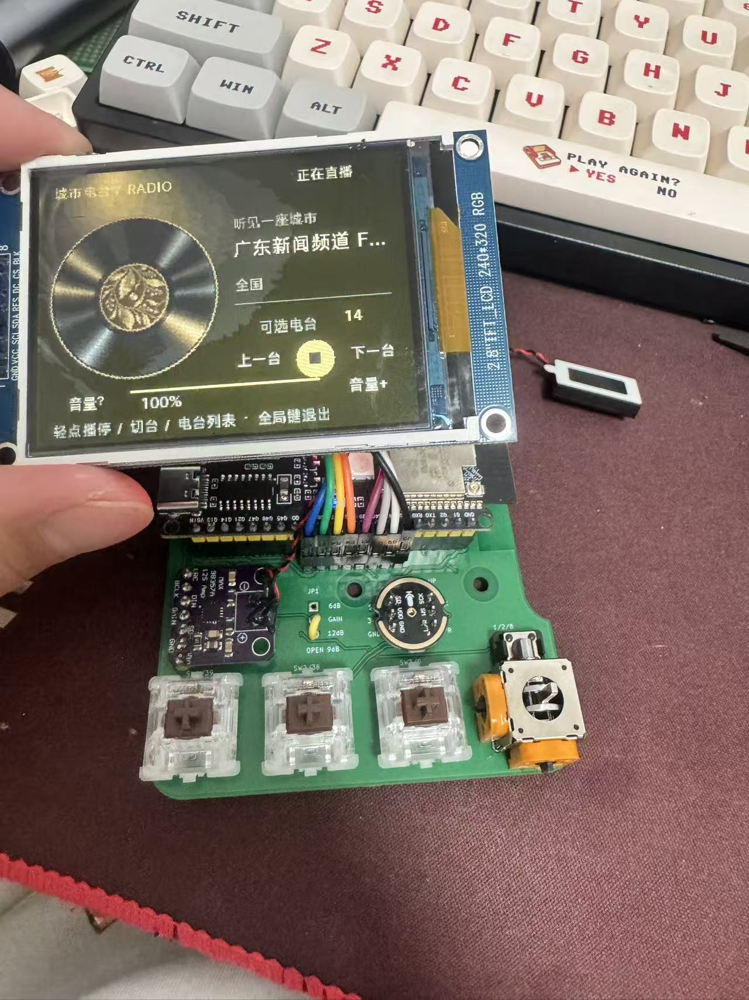
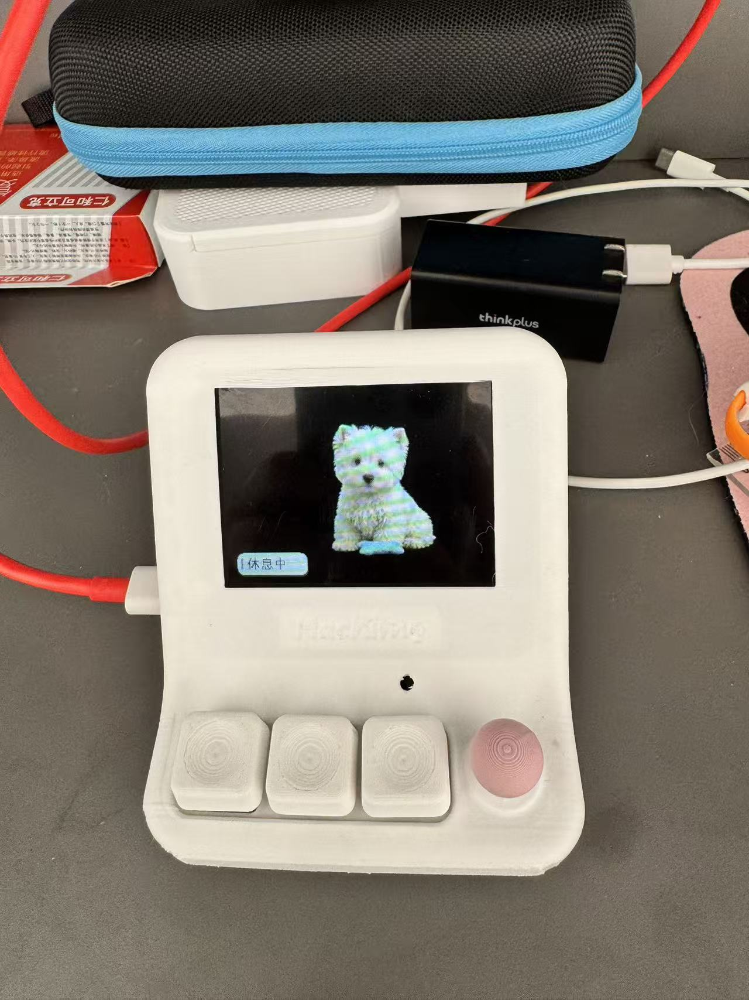

# HachimoDock-esp32s3

An unofficial ESP32-S3 A4 adaptation with **three buttons and a four-way joystick with center press**, a landscape 320×240 display, a desktop pet and offline games.

Maintained by [gmingtian](https://github.com/gmingtian), based on **Yizheng Wang / [YizhengWw/HachimoDock](https://github.com/YizhengWw/HachimoDock)**. Original attribution, [LICENSE](LICENSE) and [third-party notices](THIRD_PARTY_NOTICES.md) are retained. This fork is not endorsed by the upstream project.

[0.1.202 prerelease downloads](https://github.com/gmingtian/HachimoDock-esp32s3/releases/tag/v0.1.202-s3-a4-r16c) · [Installation](docs/INSTALLATION.md) · [A4 controls](docs/ESP32-S3-A4-Controls.md) · [PCB and enclosure](hardware/README.md) · [Compatibility](docs/COMPATIBILITY.md) · [中文](README.md)

Current release: desktop **0.1.202 A4 custom prerelease**, firmware **0.7.103-s3-r16c-80m-l320**. Windows x64, Apple Silicon macOS arm64 (13.5+) and Linux x86_64 packages have passed native builds, resource conversion and frontend startup validation. Intel Mac and Linux ARM builds are not advertised.

## The assembled device

| A4 PCB running City Radio | Enclosed device running the pet |
| --- | --- |
|  |  |

These are unchanged photographs of the actual assembled unit. They do not establish fit for every print material or module batch, full joystick travel, RF certification or acoustic performance.

## Downloads

| File | Direct download | Details |
| --- | --- | --- |
| Windows client | [Windows x64 installer](https://github.com/gmingtian/HachimoDock-esp32s3/releases/download/v0.1.202-s3-a4-r16c/HachimoDock-esp32s3_Windows-x64.exe) | NSIS installer |
| macOS client | [macOS ARM64 DMG](https://github.com/gmingtian/HachimoDock-esp32s3/releases/download/v0.1.202-s3-a4-r16c/HachimoDock-esp32s3_macOS-arm64.dmg) | Apple Silicon, macOS 13.5+; ad-hoc signed, not notarized |
| Linux client | [Linux x86_64 archive](https://github.com/gmingtian/HachimoDock-esp32s3/releases/download/v0.1.202-s3-a4-r16c/HachimoDock-esp32s3_Linux-x64.tar.gz) | Ubuntu 24.04 baseline; extract and run `launch.sh`; see installation notes for system dependencies |
| PCB and complete enclosure | [A4 hardware and R4.4 enclosure](https://github.com/gmingtian/HachimoDock-esp32s3/releases/download/v0.1.202-s3-a4-r16c/HachimoDock-A4-hardware-R4.4.zip) | Gerbers, KiCad, BOM, wiring, upper/lower STL and STEP, and control parts |
| Separate keycaps and joystick | [6 individual STL parts](https://github.com/gmingtian/HachimoDock-esp32s3/releases/download/v0.1.202-s3-a4-r16c/HachimoDock-A4-keycaps-joystick-STL.zip) | Three keycaps, joystick outer cap, connector and cover; mm, 100% scale |
| S3 application update | [r16c OTA firmware](https://github.com/gmingtian/HachimoDock-esp32s3/releases/download/v0.1.202-s3-a4-r16c/HachimoDock-S3-A4-r16c-OTA.bin) | Application update for an existing compatible A4 partition layout |
| S3 initial flash / recovery | [r16c clean factory package](https://github.com/gmingtian/HachimoDock-esp32s3/releases/download/v0.1.202-s3-a4-r16c/HachimoDock-S3-A4-r16c-factory.zip) | Initial flashing or full recovery; replaces configuration and resources; follow the included instructions |

[All assets, games and source](https://github.com/gmingtian/HachimoDock-esp32s3/releases/tag/v0.1.202-s3-a4-r16c) · [SHA256SUMS](https://github.com/gmingtian/HachimoDock-esp32s3/releases/download/v0.1.202-s3-a4-r16c/SHA256SUMS) · [Installation and recovery](docs/INSTALLATION.md). All 24 release assets have been downloaded back and verified.

## Features

- Native **320×240 composition**, 80MHz SPI, Chinese menus, session bubbles and animation/partial refresh optimizations. This unit has passed visual checks at 80MHz; other displays and cables require validation. Asset frame rate limits are not measured device FPS.
- A4 button/joystick controls replace the former button-only fallback. The joystick navigates; button 1 confirms or holds to record, button 2 opens components, button 3 returns. Controls are configurable in the desktop app.
- Cloud Hop, Pixel Blocks and Bloom Frog are restored. Offline human-versus-AI Gomoku and Xiangqi run on the device without a computer performing the search.
- Xiangqi offers three difficulty levels and legal-destination cursor guidance for all seven piece types. r16c shortens AI slice waits without changing depth, work limits or evaluation. All 36 comparison positions matched; one fixed-opening hard-mode device measurement improved from about 4.60s to 2.20s. See the [validation record](docs/ESP32-S3-r16c-Xiangqi-Speed.md) for scope.
- Agent sessions, avatar/component synchronization, USB and paired local-network Wi-Fi, configurable buttons and voice-service integration. Cloud services require the appropriate credentials and network. Linux cross-application input automation has limitations.
- S3 chip/project checks reject P4 firmware; OTA transactions and rollback are retained. Verify the board and download checksums before updating.

## Hardware and controls

ESP32-S3 N16R8 (16MiB Flash, 8MiB PSRAM), 240×320 ST7789 mounted landscape at 320×240, INMP441 microphone and MAX98357A amplifier. The display ribbon is on the left when viewed from the front.

| Interface | GPIO |
| --- | --- |
| SW1 / SW2 / SW3 | 39 / 38 / 0 |
| Joystick X / Y / center | 1 / 2 / 8 |
| LCD CLK / MOSI / RST / DC / CS / BL | 21 / 47 / 45 / 40 / 41 / 42 |
| Microphone WS / BCLK / DIN | 4 / 5 / 6 |
| Amplifier DOUT / BCLK / LRCK | 7 / 15 / 16 |

Release GPIO0 during boot/reset. Gomoku: button 1 start/place/restart, 2 undo, 3 exit. Xiangqi: button 1 select/place, 2 cancel selection or undo, 3 exit; up/down selects difficulty before starting. Follow each game's on-screen instructions.

The [hardware index](hardware/README.md) identifies current **A4 Gerbers, editable KiCad PCB/schematic and local libraries, BOM, wiring, R4.4 upper/lower STL and STEP, plus separate original keycaps and joystick A/B/cover STL files**. Earlier PCB/enclosure revisions and fit-test skeletons are historical inputs, not the recommended manufacturing set.

## Install and build

Choose matching desktop and S3 firmware files from the [Release](https://github.com/gmingtian/HachimoDock-esp32s3/releases/tag/v0.1.202-s3-a4-r16c) and read [installation and recovery](docs/INSTALLATION.md). Installing the desktop app does not flash the board. Application-only firmware must not be written to 0x0; initial factory flashing and resource-preserving OTA are different operations.

See [S3 build/wiring](docs/ESP32-S3-Linux.md), [native Linux desktop](pc/docs/linux-native.md) and the `pc/` project. Docker is optional; native Node, Rust and ESP-IDF environments can build the respective targets. Fork macOS packages are not claimed to be Apple-notarized.

This package targets the A4 S3 board; sharing game cores with P4 does not make the S3 firmware flashable on P4. A joystick does not provide a touchscreen. S3 voice uses the half-duplex path; calibrated full-duplex/AEC is not claimed. See [compatibility](docs/COMPATIBILITY.md).
