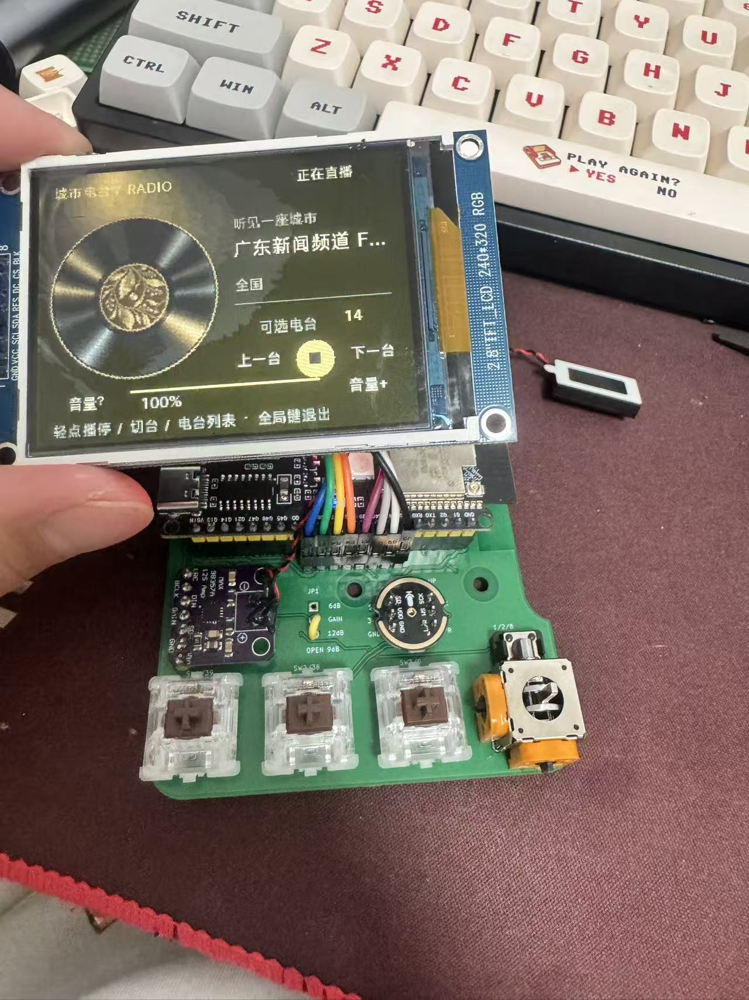
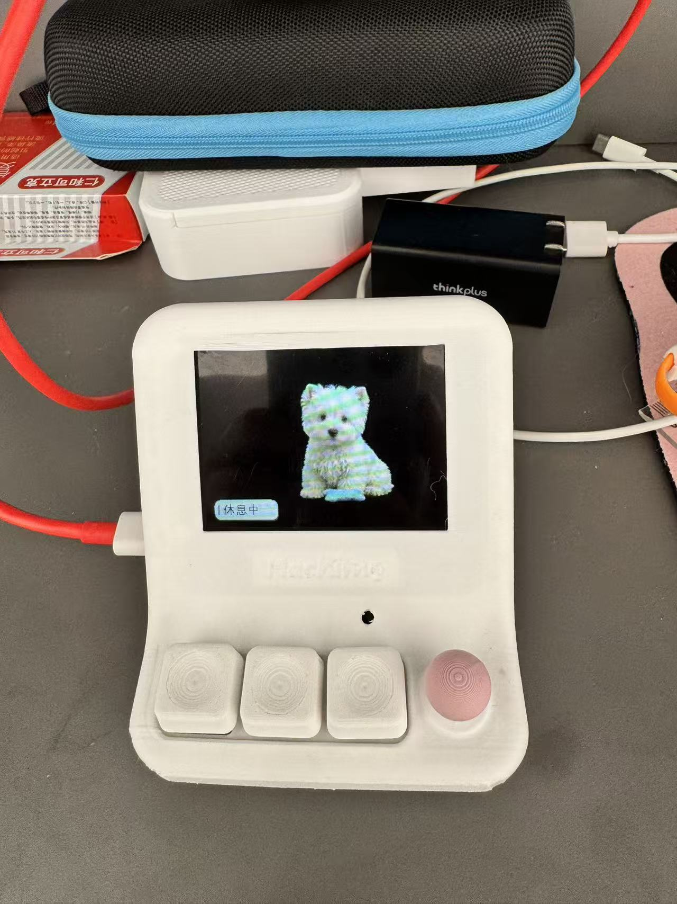

# HachimoDock-esp32s3

ESP32-S3 A4 载板适配版：**三颗按键＋四向摇杆（支持按下）**，320×240 横屏桌宠与离线小游戏。

本仓库由 [gmingtian](https://github.com/gmingtian) 维护，基于 **Yizheng Wang / [YizhengWw/HachimoDock](https://github.com/YizhengWw/HachimoDock)**。这是非官方修改版，保留原项目署名、[许可证](LICENSE)及[第三方声明](THIRD_PARTY_NOTICES.md)，不代表上游背书。

[下载 0.1.202（预发布）](https://github.com/gmingtian/HachimoDock-esp32s3/releases/tag/v0.1.202-s3-a4-r16c) · [安装与恢复](docs/INSTALLATION.md) · [按钮与摇杆](docs/ESP32-S3-A4-Controls.md) · [PCB 与外壳](hardware/README.md) · [兼容性](docs/COMPATIBILITY.md) · [English](README.en.md)

当前发布：客户端 **0.1.202 A4 定制预发布版**；配套固件 **0.7.103-s3-r16c-80m-l320**。Windows x64、Apple 芯片 macOS arm64（13.5+）、Linux x86_64 安装包均已完成原生构建、资源转码和界面启动验证。

## 实物

| A4 焊接板，城市电台 | 装壳整机，桌宠首页 |
| --- | --- |
|  |  |

以上为本机真实照片，保留原图。PCB 已焊接并完成这台设备的装壳使用；照片不替代其他打印材料、模块批次、极限摇杆行程或无线/声学测试。

## 下载

| 文件 | 直达下载 | 说明 |
| --- | --- | --- |
| Windows 客户端 | [Windows x64 安装包](https://github.com/gmingtian/HachimoDock-esp32s3/releases/download/v0.1.202-s3-a4-r16c/HachimoDock-esp32s3_Windows-x64.exe) | NSIS 安装程序 |
| macOS 客户端 | [macOS ARM64 DMG](https://github.com/gmingtian/HachimoDock-esp32s3/releases/download/v0.1.202-s3-a4-r16c/HachimoDock-esp32s3_macOS-arm64.dmg) | Apple 芯片，macOS 13.5+；本地签名、未公证 |
| Linux 客户端 | [Linux x86_64 压缩包](https://github.com/gmingtian/HachimoDock-esp32s3/releases/download/v0.1.202-s3-a4-r16c/HachimoDock-esp32s3_Linux-x64.tar.gz) | Ubuntu 24.04 基线；解压后运行 `launch.sh`，系统依赖见安装说明 |
| PCB 与完整外壳 | [A4 硬件及 R4.4 外壳包](https://github.com/gmingtian/HachimoDock-esp32s3/releases/download/v0.1.202-s3-a4-r16c/HachimoDock-A4-hardware-R4.4.zip) | Gerber、KiCad、BOM、接线表、上下盖 STL / STEP 及操作件 |
| 单独键帽与摇杆 | [6 件独立 STL](https://github.com/gmingtian/HachimoDock-esp32s3/releases/download/v0.1.202-s3-a4-r16c/HachimoDock-A4-keycaps-joystick-STL.zip) | 三个键帽＋摇杆外帽、连接件、盖板；mm，100% 比例 |
| S3 应用升级 | [r16c OTA 固件](https://github.com/gmingtian/HachimoDock-esp32s3/releases/download/v0.1.202-s3-a4-r16c/HachimoDock-S3-A4-r16c-OTA.bin) | 已有匹配 A4 分区布局的设备应用升级 |
| S3 首次刷写 / 恢复 | [r16c 干净全量包](https://github.com/gmingtian/HachimoDock-esp32s3/releases/download/v0.1.202-s3-a4-r16c/HachimoDock-S3-A4-r16c-factory.zip) | 首次改刷或完整恢复；会替换配置与资源，按包内说明刷写 |

[全部附件、游戏与源码](https://github.com/gmingtian/HachimoDock-esp32s3/releases/tag/v0.1.202-s3-a4-r16c) · [SHA256SUMS 校验文件](https://github.com/gmingtian/HachimoDock-esp32s3/releases/download/v0.1.202-s3-a4-r16c/SHA256SUMS) · [安装与恢复说明](docs/INSTALLATION.md)。24 个附件均已实际回下载校验。

## 当前功能

- **原生 320×240 合成、80MHz SPI**，保留动画与会话气泡、中文菜单及局部刷新优化。80MHz 已在这台设备试用正常，其他屏幕或长排线需自行验收；素材帧率上限不等于整机实测帧率。
- **A4 官方按钮/摇杆操作方式**：摇杆导航，1 键确认及按住语音，2 键组件中心，3 键返回。已移除早期纯三键替代摇杆的软件操作模式。
- **组件和游戏**：恢复云端跳一跳、像素方块、蛙蛙养成；加入离线人机五子棋、中国象棋。象棋支持简单/普通/困难和全部棋种的合法落点光标引导，选中棋子后可用摇杆跳到候选位置。
- **象棋 r16c 优化**：只缩短 AI 分片等待，保持搜索深度、工作量和评分；36 个变化局面对比结果一致。固定开局困难档单次设备对比约 4.60 秒→2.20 秒，不能代表所有局面的耗时，详见[验证记录](docs/ESP32-S3-r16c-Xiangqi-Speed.md)。游戏独立在设备运行，无需电脑计算。
- **配套客户端**：Agent 会话、形象及组件同步、USB / 局域网 Wi-Fi、按键配置、语音服务入口。联网服务仍需相应账号、凭据与网络；Linux 跨应用自动填字有限制。
- **升级保护**：S3 芯片与项目名校验，防止误刷 P4 镜像；OTA 事务及回滚机制。升级前仍应核对目标板与附件校验值。

## 硬件和操作

目标为 ESP32-S3 N16R8（16MiB Flash / 8MiB PSRAM）、240×320 ST7789 横装为 320×240、INMP441 和 MAX98357A。屏幕正视排线在左侧，使用 A4 PCB 对应接线。

| 接口 | GPIO |
| --- | --- |
| SW1 / SW2 / SW3 | 39 / 38 / 0 |
| 摇杆 X / Y / 按下 | 1 / 2 / 8 |
| LCD CLK / MOSI / RST / DC / CS / BL | 21 / 47 / 45 / 40 / 41 / 42 |
| 麦克风 WS / BCLK / DIN | 4 / 5 / 6 |
| 功放 DOUT / BCLK / LRCK | 7 / 15 / 16 |

GPIO0 上电或复位时请松开。按键可在客户端配置，具体游戏以屏幕提示为准。五子棋：1 开始/落子/重开，2 悔棋，3 退出。象棋：1 选棋/落子，2 优先取消选中、否则悔棋，3 退出；上下选择难度。

[硬件交付索引](hardware/README.md)列出 **A4 Gerber、KiCad 原理图/PCB、自包含库、BOM、接线表、R4.4 上下盖 STL 与 STEP，以及单独的三键帽和摇杆帽 A/B/盖板 STL**。早期 A0–A3、R0–R4.3 与试装骨架属于过程资料，请勿混用制造文件。

## 安装和开发

从 [Release](https://github.com/gmingtian/HachimoDock-esp32s3/releases/tag/v0.1.202-s3-a4-r16c) 选择对应系统客户端及 S3 固件附件，先阅读[安装与恢复](docs/INSTALLATION.md)。安装客户端不会自动刷机；应用镜像不能写入 0x0，首次完整刷机与保留资源的 OTA 升级用途不同。

开发依赖与命令见 [S3 构建/接线](docs/ESP32-S3-Linux.md)、[Linux 客户端](pc/docs/linux-native.md)及 `pc/` 工程。Docker 是可选构建方式，使用本机 Node、Rust、ESP-IDF 也可完成相应构建。

本版本针对 A4 S3 硬件；P4 共用的游戏核心不等于本包可直接刷入 P4。触屏专用组件不因摇杆适配而具备触屏能力。语音采用当前 S3 半双工路径，未声明经声学校准的全双工/AEC。完整边界见[兼容性](docs/COMPATIBILITY.md)。
