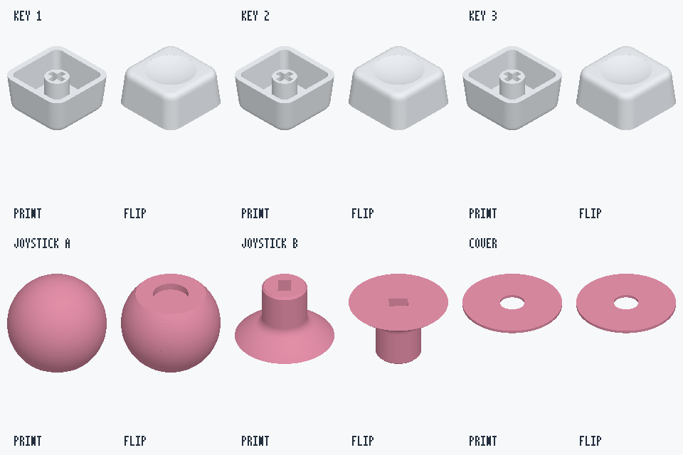

# 原版键帽与摇杆帽打印件

这里补齐 A4 三颗按键＋一个摇杆的独立打印件。来源为用户提供的原版 3MF，按原工程明确对象名提取，没有重新画外形、改孔径、缩放或合并零件。上下盖仍使用 [R4.4 正式文件](../README.md#下载编辑与切片)。

| 原工程名称 / 对象 ID | 打印文件 | 数量 | 导出包络，mm |
| --- | --- | ---: | --- |
| 按键1 / 6 | [keycap-1.stl](keycap-1.stl) | 1 | 18 × 18 × 9 |
| 按键2 / 8 | [keycap-2.stl](keycap-2.stl) | 1 | 18 × 18 × 9 |
| 按键3 / 10 | [keycap-3.stl](keycap-3.stl) | 1 | 18 × 18 × 9 |
| 摇杆帽A / 14 | [joystick-cap-a.stl](joystick-cap-a.stl) | 1 | 约 13.993 × 13.993 × 11.947 |
| 摇杆帽B / 16 | [joystick-cap-b.stl](joystick-cap-b.stl) | 1 | 约 9.887 × 9.887 × 6.045 |
| 摇杆盖板 / 12 | [joystick-cover.stl](joystick-cover.stl) | 1 | 约 13.997 × 13.997 × 0.400 |

三颗键帽各打一件；一个摇杆对应原工程提供的 A、B、盖板三种独立件各一件。没有把原版多件结构擅自变成单体。源对象编号/名称用于追溯，不代表 GPIO 或 SW 编号。A 为球形外帽，B 为带方孔的连接件，盖板为薄环；具体压入/固定与装配顺序请以原件结构和实物配合确认。

## 预览与切片



每格左侧 PRINT 为原 3MF 打印方向的网格观察，右侧 FLIP 为翻面观察；这张图由实际导出三角网格直接渲染，白色与粉色只是按用户实物照片区分零件的示意配色。不是 AI 重绘或新实物打印照片。

- STL 本身不记录单位，请在切片器按 **mm、100% 比例**导入，每个文件一件。原 component 与 build 旋转/变换已应用，只移除原打印盘的绝对位置，让每件包络最小点为 XYZ=0；没有改变原来的倾斜角度或尺寸。
- 按照片配色可使用白色键帽、粉色摇杆件，颜色由耗材决定。STL 不携带原打印机、AMS、温度或耗材配置。
- 检查切片预览中的轴孔、凹槽、薄盖板及支撑，按实际打印机/材料选择参数。不要自动缩放、填实连接孔或把 A/B/盖板布尔合并。本次未验证新的材料公差、压配松紧或打印成功率。
- 六份 STL 已回读，均为闭合、绕向一致、单一连通网格，零退化三角形；三角面数量保持源文件，float32 顶点量化误差均小于 0.000005mm。数字检查不代表本轮已经实物打印验收。

## 来源、署名与复现

源文件记录名：`user-p1s-white-orange-two-plates.3mf`。

SHA-256：`766b57fe7ed751a912be640ca9cb538da702cf437b72fbee112a83adadb6ca65`。

源 3MF 中六个对象都有上述明确名称；版权、Designer、License 字段为空，没有据此推断新的作者或授权。保留仓库原有 **Yizheng Wang / [YizhengWw/HachimoDock](https://github.com/YizhengWw/HachimoDock)** 上游项目署名与[项目许可证](../../../LICENSE)，第三方/原模型权利仍归各自权利人，本次提取不另设许可或暗示官方背书。

原 3MF 包含打印机配置和可能的本机元数据，因此不整体公开。这里仅公开上述零件、[来源与逐件变换/校验记录](source-and-verification.json)、[标准库提取脚本](../extract_print_parts.py)及网格预览；记录中不包含个人绝对路径。用户提供的 [原始 STEP](../reference/original-assembly.STEP)继续作为原版装配几何参考，但本组 STL 明确来源于命名更完整的上述 3MF，不宣称两个格式的曲面离散精度相同。

持有匹配原 3MF 时，可在仓库根目录重新提取：

```sh
python hardware/enclosure-a4/extract_print_parts.py \
  --source /path/to/user-p1s-white-orange-two-plates.3mf \
  --output /path/to/new-output
```

脚本只依赖 Python 标准库；先校验完整源 SHA，再校验对象 ID/名称及 mm 单位，读取原始顶点和面索引，依次应用 component、build 变换并只做打印盘平移归零。闭合性、连通性、绕向、体积变化和 STL 回读均会检查；不做平滑、重网格、封洞或自动修复。
