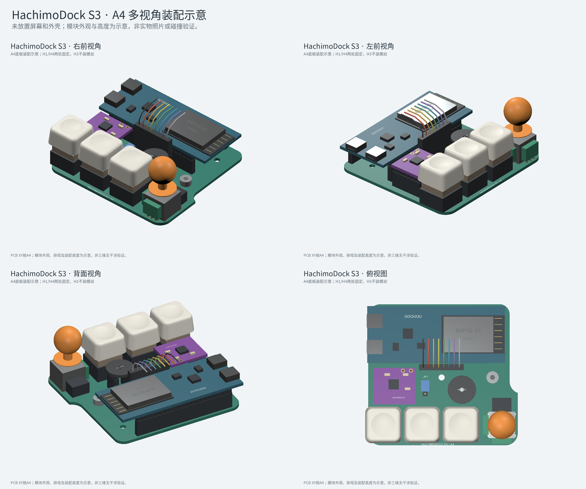

# HachimoDock ESP32-S3 一体底板 A4

状态：**已布线的工程样板，尚未实物验证；Gerber 用于小批量工程打样，不能代替整机装配及上电验证。**

[下载 A4 Gerber 制造文件](output/HachimoDock-S3-carrier-A4-Gerber.zip) · [BOM](output/BOM.csv) · [接线表](output/connections.csv) · [电气核对](output/electrical-audit.md) · [平面间隙核对](output/mechanical-audit.md)

Gerber ZIP 的 SHA256 为 `f37d6a4aacb843249476b656e248e3e576f963c258f840ecbc87fd694797cb69`，对应 PCB SHA256 为 `3ea5f653f6bf27bdb09c90290e1f22ae493803e0c346911ff89b9b5f40b8624e`；逐文件校验见 `output/manufacturing-export.json`。本次装配说明及渲染修订未改变该 PCB 或 Gerber。

**A4 在 A3 上增加 JP1 功放增益跳线座。** 所有原有模块、屏幕接口、按键、摇杆、板框及孔位保持 A3 坐标，仅增加三针排针及 GAIN 网络，并重新布线和检查。已上传嘉立创的 A3 Gerber 不包含此功能，须替换为 `HachimoDock-S3-carrier-A4-Gerber.zip`。

**A3 修正了 A2 的 H3 螺丝头与屏幕插头空间不足问题。** 原安装孔及整体布局不动，仅将 J1 屏幕排针向上移动1.6mm，Y=32.6→31.0mm。按杜邦插头最大22×3mm、固定螺丝头最大Ø6mm核算，上侧ESP32排母/下侧螺丝头分别留约0.54/0.56mm平面余量。A2压缩包仅作历史备份，其2.14mm上侧间隙和缺少螺丝头的检查不能用于A3。实际排母宽度、螺丝外径、高度和装配仍需核准。

保留原版 V1.2 板框、五个安装孔、三个机械轴与 YA13S 摇杆的位置，改为一块底板承载果云 ESP32-S3、MAX98357A 和圆形 INMP441。板框约 **73.47 × 69.47 mm**，双层、1.6 mm；现有 LCD、麦克风、功放与三个按键的 GPIO 保持代码定义。

**采用现有 GPIO 直连接线：删除 A0 的 Q1、Q2、R1、R2、R3，BL 直接接 GPIO42；功放 GAIN 接 JP1 中间针，通过一个跳线帽选增益；SPK+/SPK− 只在功放模块上接喇叭，底板不设置对应焊盘、孔和网络。** 不新增分立电阻、电容、三极管或 MOS 管，保留现成模块上的原有器件。旧 A0 压缩包另外保留，不能与 A2 混用装配说明。

**A2 在此基础上旋转果云板 180°，再向左侧 USB 端平移 3 mm，USB 朝向原版同一侧并靠近板边。重新映射的是底板排母的物理位置；每根编号引脚对应的电源/GPIO 网络不变。A1 开发板不能在旧底板上直接反插。** A0、A1 压缩包及输出另行保留。

## USB 位置方案选择

比较了两种平面布局：旋转后 USB 朝左，以及保持原方向、平移后 USB 朝右；两种都按接口端贴近板边安排。最终选择 **旋转后 USB 朝左的 A2**，因为 USB 方向与原版一致，LCD 的 CLK/MOSI 引脚到屏幕插针的直线距离更短。不旋转的右侧方案有更短的音频线，但会把外壳 USB 孔换到另一侧；当前网格布线器也未完成该比较方案，不能据此断定人工布线不可行。

`output/usb-options.json` 记录两种朝向的引脚距离及判断依据。这些距离是几何直线下限，不是最终铜箔长度，也不代表实测速率。A3 的实际布线单独通过原生 DRC。

按当前参考封装包络，USB 端外形到达底板左侧 **X≈−0.525 mm**，约外伸 0.5 mm；它不是实测 USB 金属接口面的坐标。果云板两个 USB 接口的位置、高度、插头壳体及原壳开孔仍需核准。即使方向相同，也不能承诺直接对准原 USB 孔；后续 STL 按实际接口做开孔和插头让位。用于桌面客户端连接的是原生 USB 口，不能把另一个串口转换接口视为完全相同的通信口。

天线随开发板转到右侧，禁布区扩大到右板边。当前装配仅使用 H1、H4 两处固定，H2 不安装螺钉；若后续结构确需使用靠近天线的 H2，应采用与孔位及结构匹配的尼龙等非金属紧固件。不要将金属件、屏幕背板和线缆压在天线附近。Wi-Fi 性能尚未经过实物验证。

为保持原板框、五孔和 USB 靠边，当前禁布区没有实现天线周围全方向 15mm 净空，天线下方仍有底板基材。它是明确保留的布局限制，不能把两层无铜和尼龙螺钉等同于完全满足 RF 推荐布局；[乐鑫的天线布置指南](https://docs.espressif.com/projects/esp-hardware-design-guidelines/en/latest/esp32s3/pcb-layout-design.html#general-principles-of-pcb-layout-for-modules-positioning-a-module-on-a-base-board)要求在成品中验证吞吐和距离。

## 布局锁定与本次优化

板框、五个安装孔、SW1/SW2/SW3 和原版 YA13S 的坐标、机械孔径、间距及方向锁定原版；保留原版约14mm 3D打印圆帽，整体布局不再调整。封装焊盘与孔位逐个比对原源文件。摇杆金属脚的铜焊盘仅缩小0.2mm以满足板边间距，原钻孔与机械定位不变。

J1 位于 Y=31.0mm，麦克风中心仍为 (46,42.1)mm。屏幕插头按**最大22×3mm**的8P杜邦外壳预留，与果云下排排母的平面间隙约**0.54mm**，与H3的Ø6mm螺丝头约**0.56mm**，与麦克风包络间隙**2.60mm**；麦克风至右侧键帽预留约**1.07mm**。这些数值使用规划包络，实际连接器或螺丝超出该规格时需重新核对，不能只看金属针或钻孔间距。

五个原固定孔均保留。**参考原壳采用中排左右 H1、H4 两处螺丝固定；中排中央 H3 用于定位/支撑，不安装螺丝，H2、H5 同样不要求安装螺丝。** H1/H4 的坐标分别约为 (11.041,36.003)mm 和 (61.056,36.027)mm，H3 约为 (36.044,36.060)mm。

原五孔周围半径3.5mm的两层铜、走线及过孔禁布区继续保留。检查报告中的五处Ø6mm螺丝头是保守包络假设，不是五颗螺丝的装配要求；H3无螺丝也不代表可以忽略外壳定位柱的实际尺寸。先装实际使用的固定螺丝，再插开发板和音频模块。原版资料列出两颗 M2.5×6 螺丝及两枚 M2.5×4×3.5 热熔铜螺母；具体安装深度和孔位仍须与实际外壳核对。

功放的3V3馈线和地线分别直接连开发板电源脚，避免刻意经麦克风或屏幕串接。两层已填充GND铜，避开右上天线区并去掉孤岛，屏幕地附近增加接地过孔；新增元件仅有 JP1 三针排针及一个跳线帽，没有增加电阻、电容或有源器件。铺铜改善返回路径，不能替代供电容量和音频噪声实测。

摇杆活动区为新增模块/插头保守预留R15mm，**不是帽子直径，也不是实测运动边界**。厂家机械图给出总角60°，规划再考虑角度公差。摇杆帽高于底板元件的高度差有助于避免干涉，但原版摇杆与右侧键帽的完整运动、按压及线缆/屏幕三维间隙仍待核对；不因保守俯视投影相交而移动原版控制器件，也不声称已完成三维无干涉验证。

## 工程文件

- `output/HachimoDock-S3-carrier-A4.kicad_pcb`：主设计，已运行 KiCad 9 原生 DRC。
- 同名 `.kicad_pro`、`fp-lib-table`、`S3_Carrier.pretty/`：工程规则和自包含封装库，应一起打开。
- `output/HachimoDock-S3-carrier-A4.epro2`：嘉立创专业版 PCB 交换文件。焊盘、网络、孔、走线坐标已程序比对，铺铜包含天线角及五个螺丝头的让位；**本次未完成编辑器导入验证，它不是本次DRC的对象，也未转换KiCad原生天线/螺丝头禁布规则**。请以KiCad主设计为准，导入后必须重新设置这些规则、检查铺铜并运行DRC。
- `output/connections.csv`：逐焊盘网络表；`design.json`：全部坐标及布局边界。
- `output/validation.json`、`drc.json`：检查结果；`pcb-preview.png`：按真实坐标绘制的布局与布线图。
- `output/electrical-audit.md/json`：直接从最终 KiCad PCB 焊盘读取的 15 路固件信号与电源核对表，包含当前代码和 PCB 的校验值；`audit-fault-checks.json` 记录六种故意错误均被检出（新增增益接错和跳线中心脚接错）。
- `output/mechanical-audit.md/json`：插头、排母、模块与键帽的尺寸间隙，以及摇杆运动检查的边界。
- `output/drc-attestation.json`：原生DRC结果与最终PCB、工程规则的校验值绑定；修改任一文件后拒绝沿用旧报告打包。
- `output/assembly-orientation.png/svg`：圆形麦克风正面针序、排母插装方向和屏幕直通排线图。
- `output/assembly-render/`：按PCB坐标及原版STEP帽/键帽生成的装配示意。模块电子元件、USB外观和Z高度是示意值；未显示尺寸未确认的屏幕本体，不是实物照片或三维碰撞验证。

图中只展示 H1/H4 两处螺丝；俯视、前后视角沿用同一套 PCB 坐标。带外壳的 AI 概念图不作为本工程的尺寸或装配依据。

本次提供 PCB 和网络表，未提供可与 PCB 自动联动的完整原理图工程。

## 装配与接口

1. 果云 **42 针 N16R8** 使用两条 **2.54 mm 1×21P 排母**，两排中心距 25.4 mm。已买的 1×22P 可裁成 21P；不要买成 44 针开发板的底座。A2 开发板 USB 朝左、天线朝右。先以实物逐一核对丝印与 `connections.csv`，不能照 A1 的朝向插装。
2. 三个轴体和原版 YA13S 摇杆焊在原位置；此封装用于原版裸摇杆，**不能把已买的 PS2 小模块当成同尺寸、同引脚封装直接插入**。
3. MAX98357A 使用一条 **1×7P、2.54 mm 排母**，按 VIN/GND/SD/GAIN/DIN/BCLK/LRC 七针接口对位；VIN 保持用户确认的 **3V3**，SD 接 3V3，GAIN 接 JP1 中间2脚，1脚接3V3，3脚接GND；具体见下方增益表。喇叭直接接模块 SPK+/SPK−，**这两个喇叭端子不与底板连接，SPK− 不接地**。
4. 圆形 INMP441 采用两条 **1×3P、2.54 mm 排母，两排中心距 7.62 mm**，不是一只排距 2.54 mm 的 2×3P 排母。用户提供的商家图标注直径 14 mm、排距 7.62 mm，与封装一致。按已焊排针照片安装：**带字面朝外，长针向下插排母**。从底板元件面看，模块左列从上到下 SD→GPIO6、VDD→3V3、GND→GND；右列从上到下 SCK→GPIO5、WS→GPIO4、L/R→GND。无需拆针或镜像插装。商家图片中的 GPIO14/32/15 是示例，不用于本板。
5. J1 方形焊盘为 1，从底板元件面由左到右为：**GND、VCC、SCL、SDA、RES、DC、CS、BLK**，与用户屏幕照片一致，可用一组 8P 杜邦线 1 对 1 直连。VCC=3V3；SCL=GPIO21、SDA=GPIO47、RES=GPIO45、DC=GPIO40、CS=GPIO41、BLK=GPIO42。插接时先确认两端 GND 对应，不要因从背面看接口而倒序。建议先使用约 5 cm 短线，最终线长与 SPI 时钟需实测。
6. J1 的 BLK 直接接 GPIO42，沿用用户反馈可正常点亮的接法。A3 不含背光功率驱动或外加限流器件；现有屏幕正常点亮的反馈不等于已完成更换屏幕后背光电流的验证。
7. 麦克风中心预留 Ø2 mm 底板声孔；不要用胶堵住声孔。底板声孔不代表模块原孔的直径，也不代替外壳的声学开孔。
8. U1/U2/U3 的排母焊孔均按 Ø1.2 mm 设计，焊盘 Ø1.8 mm。先安装原版固定螺钉，再安装开发板和音频模块。模块下方存在原版固定孔，**排母高度、螺钉头高度、模块背部焊点间隙尚未三维确认**。功放模块的喇叭端子若向下焊接，其焊点同样需与底板保持绝缘间隙。

### 模块尺寸的依据

MAX98357A 在设计与渲染中的平面外形预留为 **20.38×18mm**，来自所采用的参考布局，不能当作已测得的商品外形。用户提供的紫色模块商品图标注约 **17×18mm**；两者应先按针排方向对齐，再核对实际针距、针排到板边距离、焊接方向及插接高度。商品图上的七针顺序与本板相符，但图中未给出全部孔位尺寸。

圆形 INMP441 按商品图的直径14mm、两排中心距7.62mm规划。果云开发板采用参考工程的42针封装。Unvision屏幕的完整机械尺寸尚未确认。排母本体、插入深度、焊点、屏幕背部及线材弯折空间尚未全部实测，不能据渲染图宣称原壳可直接安装。

## JP1 功放增益跳线

使用 **2.54 mm 1×3P 直排针 + 一个两针跳线帽**。从元件面看，JP1 竖向上到下为：1=3V3、2=GAIN、3=GND；1脚为方形焊盘。

| 跳线帽位置 | MAX98357A 在 I²S 模式下的增益 |
|---|---:|
| 1–2（上两针，丝印6dB） | 6 dB，较小 |
| 不装帽（OPEN 9dB） | 9 dB，默认 |
| 2–3（下两针，丝印12dB） | 12 dB，较大 |

该设置来自 [MAX98357A 官方手册第28页表8](https://www.analog.com/media/en/technical-documentation/data-sheets/MAX98357A-MAX98357B.pdf)，不占用ESP32 GPIO，也不用更改固件。它影响所有声音，不仅状态提示音。模块自身若已加装增益电阻或焊桥，需先核对模块线路，不能单凭引脚外观认定实际增益。

**断电后切换，只能装一个跳线帽；禁止同时跨接1–2和2–3，否则会短接3V3与GND。** 跳线帽外形限4×5.5mm，针座与两种插法的合并平面包络按4×8.5mm预留；实际排针/帽高度及外壳可操作空间尚未实物验证。增益座放在功放与麦克风之间，不改变原有部件位置。

## GPIO

| 用途 | GPIO |
|---|---|
| LCD CLK / MOSI / RST / DC / CS / BL | 21 / 47 / 45 / 40 / 41 / 42 |
| INMP441 WS / SCK / SD | 4 / 5 / 6 |
| MAX98357A DIN / BCLK / LRC | 7 / 15 / 16 |
| 原版位置三个按键 SW1 / SW2 / SW3 | 39 / 38 / 0 |
| 摇杆 X / Y / 按下 | 1 / 2 / 8（新增，需固件支持） |

USB GPIO19/20、PSRAM GPIO35/36/37 不接底板外围。摇杆使用 3.3 V 电位器供电。

## 当前验证范围与未决项

已经核对源工程 42 针符号/封装、现有代码 GPIO、原版机械定位、模块平面外形、PCB 焊盘网络和布线。KiCad DRC 不豁免违规；报告随工程提供。摇杆边缘金属脚保留原孔与位置，铜焊盘由 Ø2.0 缩到 Ø1.8 mm，以满足板边间距，孔径仍为 Ø1.2 mm。

以下需完成后才适合冻结生产版：

- 果云及两个音频模块的实际尺寸、排针方向与元件高度；螺钉、USB 插头、原壳的三维装配。
- Unvision 8 针屏幕的板框、固定孔、BL 电路和背光电流。**没有采用另一款屏幕的 54.74 × 81.28 mm 尺寸。**
- 本版功放 VIN、LCD 和麦克风由开发板 3V3 供电。开发板稳压器容量及 Wi-Fi 发射、背光和大音量同时工作时的峰值电流/温升未验证；若供电余量不足，需要调整功放电源或增加独立稳压，不能只凭 DRC 通过就认定供电可用。
- 原板宽度上能摆下这些模块，但仍不能保证沿用原壳后无物理干涉；外壳及屏幕支架未定稿。
- 新摇杆 GPIO1/2/8 的采样、死区、方向映射和去抖需另做固件适配。
- GPIO45沿用当前屏幕RES脚，但它也是S3启动采样脚；更换屏幕后需要检查RES电路的外部拉电平及冷启动稳定性，不能只以现有接线曾点亮代替检查。不要为此擅自改脚位或烧写eFuse。GPIO0按键在复位时按住可能进入下载模式，是该脚的既有行为。

## 来源与使用条件

- [HachimoDock 官方硬件工程](https://oshwhub.com/eda_gqvzlprk/project_cnbmkbjc)：V1.2 板框、孔位、机械轴及摇杆封装，原项目 [YizhengWw/HachimoDock](https://github.com/YizhengWw/HachimoDock)。
- [果云 AI 对话底板参考工程](https://oshwhub.com/ccabcd/ai-dialogue-backplane-based-on-e)：42 针果云及两种音频模块的封装/引脚依据。
- [小智 ESP32-S3 接线说明](https://xiaozhi.me/xz-docs/docs/tutorial-basics/esp32-s3-bread-board-diy-wiring/)：开发板引脚交叉核对。
- [TDK INMP441 数据手册](https://product.tdk.com/system/files/dam/doc/product/sw_piezo/mic/mems-mic/data_sheet/inmp441.pdf)：L/R 接低电平选择左声道，与当前 S3 采集代码一致。
- [YTL 原版 YA13S 数据手册](https://www.lcsc.com/datasheet/C37323748.pdf)：封装机械尺寸和摇杆角度依据。

`reference/` 保留下载的原始工程用于复核，第三方设计与封装的权利、许可和使用条件属于各自原作者；本说明不重新许可第三方内容。改版文件保留原作者归属。上传 Gerber 或完成工程审核不等于打样上电通过；制造与实物验证状态以对应记录为准。

## 重新生成

先运行 `tools/build_design.py`，再运行 `tools/route_board.py`（NumPy、Shapely）；随后以 KiCad 9 的 Python 环境运行 `tools/prepare_kicad.py`，通过 `tools/verify_drc.py --kicad-cli /path/to/kicad-cli` 运行原生DRC并生成校验记录，再运行 `tools/audit_native.py`、`tools/check_audit_faults.py` 和 `tools/check_clearances.py`。最后执行 `tools/export_easyeda.py`、`tools/preview.py`、`tools/assembly_preview.py` 和 `python -m unittest discover -s tests -v`。`tools/package_design.py` 会检查固件代码、PCB、工程规则及各报告的校验值。不要只重新生成设计而省略布线与审核。
